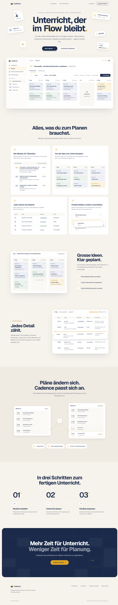
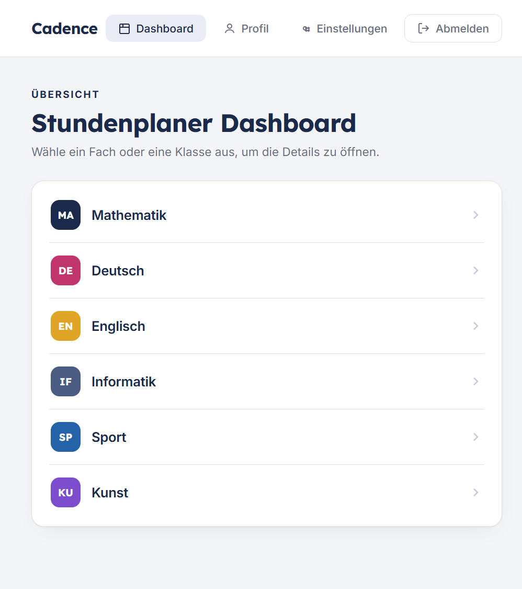
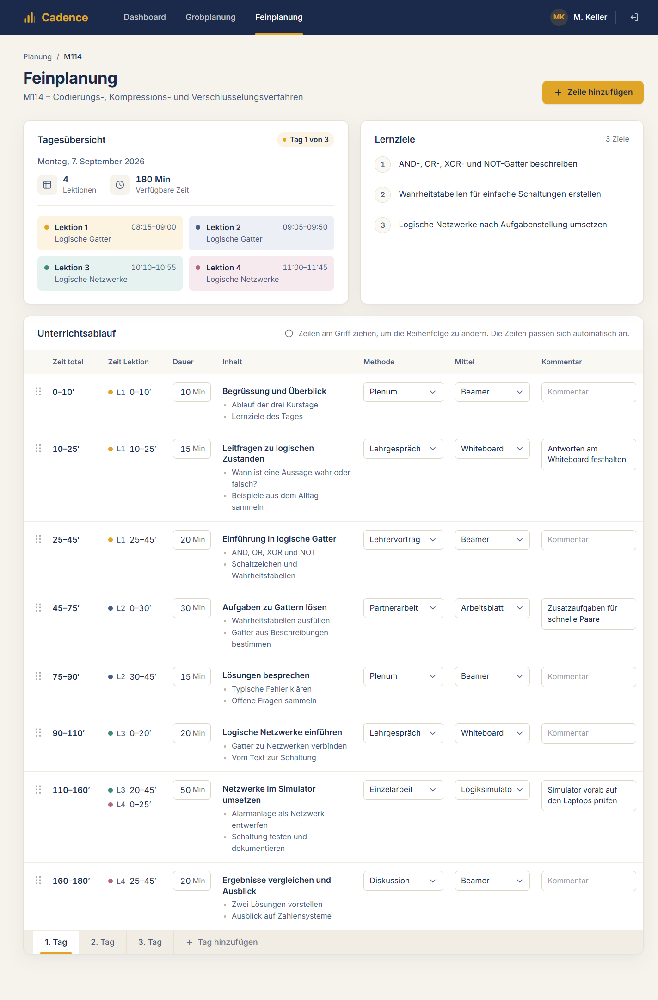

# IPT8.1 – Cadence


<p align="center">
  
</p>

## Vorschau

### Landingpage



### Dashboard



### Feinplanung



---

## Über das Projekt

**Cadence** ist eine webbasierte Plattform zur digitalen Erstellung und Verwaltung von Stundenplänen für Lehrpersonen.

Die Anwendung richtet sich an Lehrpersonen, die Module und Kurse planen möchten. Unterrichtssequenzen werden grob und fein geplant, per Drag & Drop verschoben und dauerhaft gespeichert. Ferien und abwesende Klassen können eingetragen werden, damit die Planung jederzeit aktuell bleibt.

---

## Projektziel

Ziel des Projekts ist die Entwicklung einer modernen Full-Stack-Webanwendung, mit der Lehrpersonen ihre Stundenpläne einfach erstellen, anpassen und verwalten können.

Durch dynamische Tages- und Zeilenkonfiguration, eine Kursansicht mit Datumsanzeige und Drag & Drop soll die Planung übersichtlich und flexibel möglich sein.

---

## Funktionen

### Benutzerverwaltung

* Login und Logout für Lehrpersonen
* Registrierung über Zugriffsanfrage
* Freigabe und Verwaltung der Benutzer durch Admins
* Passwort zurücksetzen
* Token-basierte Authentifizierung (JWT)

### Modulverwaltung

* Module erfassen, bearbeiten und löschen
* Lernziele pro Modul verwalten
* Unterricht und Inhalte erfassen

### Planung

* Grobplanung und Feinplanung
* Dynamische Tagesanzahl
* Dynamische Zeilen in der Feinplanung
* Kursansicht mit Datumsanzeige

### Ferien & Abwesenheiten

* Ferien und abwesende Klassen eintragen
* Einträge wieder löschen

### Drag & Drop

* Unterrichtssequenzen per Drag & Drop verschieben

### Kann-Ziele

* Automatische Erkennung von Ferien und Feiertagen
* Farbliche Kategorisierung von Unterrichtssequenzen
* Automatische Pausen
* Warnung bei Zeitüberschreitung
* Kalender- und PDF-Export
* Dark Mode

---

## Dokumentation

Die vollständige Projektdokumentation befindet sich im Ordner `Documentation`.

### Analyse & Planung

- [Pflichtenheft](Documentation/Conditions/specifications.md)
- [Grobplanung / Sprints](Documentation/rough_plan.md)
- [Projektplanung](Documentation/Projektplanung.xlsx)

### Datenbank

- [Datenbankkonzept](Documentation/Database/concept_db.md)
- [ER-Modell (Mermaid)](Documentation/Database/ERModel.mmd)
- [ER-Diagramm (draw.io)](Documentation/Database/ER_DB.drawio)
- [Migrationskonzept](Documentation/Database/MigrationConcept.md)

### Frontend & UI

- [Mockups](Documentation/Mockup/)
- [Frontend-Struktur](Documentation/Frontend/frontend_structure.md)
- [Seitenübersicht](Documentation/Frontend/page_overview.md)
- [Logo](Documentation/Frontend/Logo/)

### Backend

- [API-Endpunkte](Documentation/Backend/backend-endpoints.md)
- [Backend-Struktur](Documentation/Backend/backend-structure.md)

### Teamregeln

- [Branch- und Commit-Regeln](Documentation/branch_and_commit_rules.md)
- [Issue-Regeln](Documentation/issue_rules.md)

---

## Systemarchitektur

```text
┌──────────────────────────┐
│        Frontend          │
│      Vue 3 + Vite        │
└─────────────┬────────────┘
              │ REST API
              ▼
┌──────────────────────────┐
│         Backend          │
│    Node.js + Express     │
└─────────────┬────────────┘
              │
              ▼
┌──────────────────────────┐
│       MariaDB 11.4       │
└──────────────────────────┘
```

---

## Verwendete Technologien

### Frontend

* Vue 3
* TypeScript
* Vite
* Pinia
* Vue Router
* Tailwind CSS 4
* Headless UI
* vuedraggable

### Backend

* JavaScript (Node.js 24)
* Express 5
* JWT Authentication
* express-validator
* winston (Logging)
* REST API

### Datenbank

* MariaDB 11.4
* SQL-Migrationen (`Project/Database/changes`)

### Tests & Qualität

* Vitest (Unit-Tests)
* Playwright (E2E-Tests)
* ESLint, oxlint, Prettier

### Infrastruktur

* Docker
* Docker Compose

---

## Projektstruktur

```text
.
├── Documentation/        Pflichtenheft, Mockups, ER-Modell, API-Vertrag
└── Project/
    ├── compose.yml       Docker Compose (db, backend, frontend)
    ├── Makefile          Kurzbefehle
    ├── Backend/          Express-API (controllers, routes, models, middlewares)
    ├── Frontend/         Vue-App (pages, features, components, stores)
    └── Database/         create.sql, changes/, seeds/, rollback/
```

---

## Verfügbarkeit

Die Anwendung wird über Docker Compose bereitgestellt und kann lokal oder auf einem eigenen Server betrieben werden.

### Docker

```bash
cd Project
docker compose up --build
```

Alternativ mit Make: `make b`

| Dienst | URL |
| --- | --- |
| Frontend | http://localhost:5173 |
| Backend-API | http://localhost:3000 |
| MariaDB | `localhost:3307` |

Beim ersten Start werden Schema, Migrationen und Testdaten automatisch eingespielt.

| Befehl | Wirkung |
| --- | --- |
| `make b` / `make bh` | Build und Start (Vordergrund / Hintergrund) |
| `make u` | Start ohne Build |
| `make s` | Stoppen |
| `make d` | Container entfernen |
| `make dv` | Container und Datenbank-Volume entfernen |
| `make r` / `make rh` | Kompletter Reset und Neustart |

### Tests

```bash
cd Project/Frontend
npm run test:unit
npm run test:e2e
npm run lint
```

---

## Entwickler

Projektarbeit im Rahmen des Moduls **IPT 8.1**.

Entwickelt von:

* **Sanjivan Selvarasa** – Project Manger; Full-Stack
* **Egor Biriukov** – Database; Frontend
* **Gian Gaudenz** – Backend
* **Zoé Bachmann** – Backend

Auftraggeber: Lager Stefan

---
